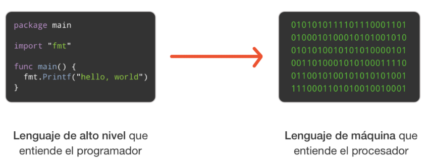
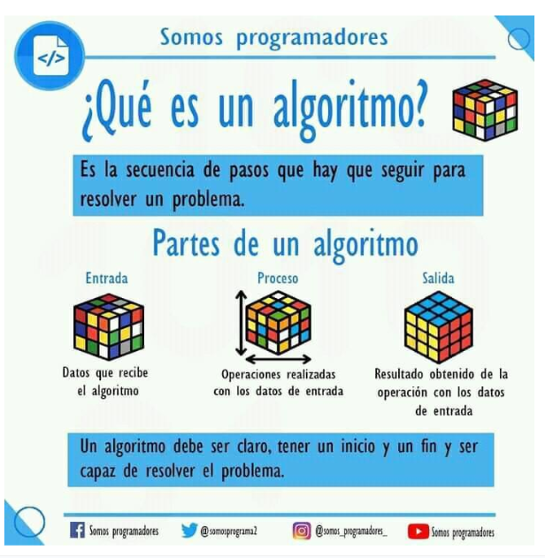

# Introducción a JavaScript


## ¿Qué es JavaScript?

JavaScript es un lenguaje de programación o de secuencias de comandos que permite implementar funciones más complejas en páginas web. Es quien le da **comportamiento** a nuestros sitios web.

### ¿Qué es un programa JavaScript?

Es una **lista de instrucciones** o **declaraciones** que el navegador ejecuta. Un programa JS puede escribirse directamente en el HTML.


#### Lenguajes compilados e interpretados

Ambos convierten el código en lenguaje de máquina (el que entienden los procesadores).

#### Diferencias:

- **Compilado:** el código se transforma completamente a lenguaje de máquina antes de ejecutarse.
- **Interpretado:** el código se traduce mientras se ejecuta.



#### Ejemplos:

- **Compilados:** C, C++, C#, Java  
- **Interpretados:** JavaScript, Python, Ruby

#### Ventajas de los lenguajes interpretados

- Ciclo de desarrollo más rápido (no requiere compilación).
- No necesita ejecutables por sistema operativo.
- Simplifica la tarea del programador.

#### Ventajas de los lenguajes compilados

- Más rápido en tiempo de ejecución (runtime).
- No requiere intérprete en el equipo del usuario.
- Código optimizado para la ejecución (mayor carga para el desarrollador).

### Expresión vs Declaración

- **Expresión**: produce un valor.

```javascript
3 + 4
nombre + " " + apellido
```

- **Declaración**: realiza una acción.

```javascript
let x = 5;
alert("Hola");
```

### Punto y coma `;`

- Separa las declaraciones.
- Permite escribir varias en la misma línea.

```javascript
let x = 5; let y = 10; alert(x + y);
```

### Espacios en blanco

JavaScript ignora múltiples espacios.  
Se recomienda usarlos para mejorar la legibilidad.

```javascript
let x = 5;
let y = 6;
```

### Palabras clave (keywords)

| Palabra clave | Uso |
|---------------|-----|
| `break`       | Termina un bucle o switch |
| `continue`    | Salta a la siguiente iteración de un bucle |
| `debugger`    | Detiene la ejecución y activa el depurador |
| `do...while`  | Ejecuta el bloque al menos una vez |
| `for`         | Bucle con contador |
| `function`    | Define una función |
| `if...else`   | Condición lógica |
| `return`      | Devuelve un valor en una función |
| `switch`      | Estructura de selección múltiple |
| `try...catch` | Manejo de errores |
| `var`         | Declara una variable (obsoleto, preferir `let` o `const`) |

### Identificadores en JavaScript

- Son los **nombres** que usamos para variables, funciones, etc.
- Deben comenzar con **letra**, **guion bajo `_`** o **signo `$`**.
- No pueden comenzar con números.
- Son **case sensitive** (sensible a mayúsculas/minúsculas).

```javascript
let nombre;
let Nombre; // es diferente a "nombre"
```

### Notación camelCase

Diferentes formas de escribir nombres compuestos:

- `first-name` → ❌ (guión medio)
- `first_name` → ✔️ (guión bajo)
- `FirstName`  → ✔️ (camelCase mayúscula, más común en C#)
- `firstName`  → ✔️ (camelCase minúscula, preferida en JavaScript)

> En JS se recomienda usar **camelCase minúscula**.

### Variables y tipos de datos

##### ¿Qué es una variable?

Una **variable** es un espacio en memoria donde podemos guardar un valor para usarlo más adelante en el programa.

##### Declaración y asignación

En JavaScript usamos palabras clave como `let` y `const` para declarar variables:

```javascript
let nombre = "Ana";
const edad = 25;
```

- `let`: permite reasignar el valor más adelante.
- `const`: no permite cambiar el valor una vez asignado.

##### Tipos de datos primitivos

- **Números** (`number`): `10`, `3.14`, `-5`
- **Cadenas de texto** (`string`): `"Hola"`, `'Mundo'`
- **Booleanos** (`boolean`): `true`, `false`

##### Operaciones matemáticas

```javascript
let suma = 10 + 5;      // 15
let resta = 20 - 3;     // 17
let producto = 4 * 6;   // 24
let division = 8 / 2;   // 4
let resto = 9 % 2;      // 1
```

##### Concatenación de textos

Podemos unir textos (strings) usando el operador `+`:

```javascript
let nombre = "Juan";
let saludo = "Hola, " + nombre;
console.log(saludo); // "Hola, Juan"
```

##### Mostrar información en pantalla

- `console.log()`: muestra en la consola del navegador.
- `alert()`: muestra una ventana emergente (popup).

```javascript
console.log("Mensaje en consola");
alert("Mensaje para el usuario");
```

##### Pedir información al usuario

- `prompt()`: muestra un cuadro para que el usuario escriba algo.

```javascript
let nombre = prompt("¿Cómo te llamás?");
alert("Hola, " + nombre);
```

### Ejemplos de métodos de salida

#### innerHTML

```javascript
document.getElementById("demo").innerHTML = "Hola mundo";
```

#### document.write()

```javascript
document.write("Texto directo en la página");
```

#### window.alert()

```javascript
alert("Esto es un mensaje");
```

#### console.log()

```javascript
console.log("Mensaje en consola");
```

#### window.print()

JavaScript no tiene acceso directo a dispositivos de impresión.  
Se puede usar:

```javascript
window.print();
```

> Imprime el contenido actual de la ventana del navegador.

### Ejemplos generales

```javascript
let nombreUsuario = "Ana";
let edadUsuario = 30;

console.log("Nombre: " + nombreUsuario);
console.log("Edad: " + edadUsuario);
```

### Características de un algoritmo



- Secuencia de pasos lógicos.
- Claros y finitos.
- Resuelven un problema o tarea específica.

----------------------

### Formas de incluir JavaScript en HTML

#### 1. En el `<head>`

```html
<head>
  <script>
    // Código JS
  </script>
</head>
```

#### 2. En el `<body>`

```html
<body>
  <script>
    // Código JS
  </script>
</body>
```

#### 3. En archivo externo

```html
<script src="app.js"></script>
```
#### Ventajas de usar archivos JS externos

- Separa HTML del código JavaScript.
- Mejora la legibilidad y mantenimiento.
- Acelera la carga (se puede usar caché).
- Se pueden incluir múltiples archivos JS.

### Variables en JavaScript

Las variables son **contenedores para almacenar datos o valores**.

```javascript
var x = 5;
var y = 10;
var z = x + y;
```

> En este ejemplo: `x`, `y` y `z` son variables.

### `let` vs `var`

#### Alcance (`scope`)

- `var`: su alcance es la **función** que la contiene. Está disponible desde el inicio de la función.
- `let`: su alcance es el **bloque `{}`** donde se define. No está disponible antes de declararse.

```javascript
function testVar() {
  if (true) {
    var x = 5;
  }
  console.log(x); // 5
}

function testLet() {
  if (true) {
    let y = 10;
  }
  console.log(y); // ReferenceError
}
```

----------------------

### Tipos de datos

En JavaScript, las variables pueden contener distintos tipos de datos:

- Números
- Cadenas de texto
- Objetos
- Booleanos
- Arreglos (arrays)
- `null`, `undefined`

### Operando con tipos de datos

#### Ejemplo 1:

```javascript
var x = 16 + "Volvo"; // "16Volvo"
```

#### Ejemplo 2:

```javascript
var x = "16" + "Volvo"; // "16Volvo"
```

> Cuando se suma un número con una cadena, JavaScript convierte todo a **string**.

### Orden de evaluación

```javascript
var x = 16 + 4 + "Volvo"; // "20Volvo"
var x = "Volvo" + 16 + 4; // "Volvo164"
```

> JS evalúa las expresiones **de izquierda a derecha**.

### Tipado dinámico

JavaScript tiene **tipado dinámico**, es decir, una variable puede cambiar de tipo:

```javascript
var x;         // x es undefined
x = 5;         // ahora es number
x = "John";    // ahora es string
```

### Cadenas de texto (strings)

Las cadenas son texto rodeado de comillas:

```javascript
var text1 = "Hola! Bienvenidos al curso de JS";
var text2 = "Hola! Bienvenidos al curso de 'JS'";
var text3 = 'Hola! Bienvenidos al curso de "JS"';
```

> Se puede usar comillas simples o dobles.

### Números

Solo hay un tipo de dato numérico en JS, con o sin decimales:

```javascript
var x1 = 34.00;  // con decimal
var x2 = 34;     // sin decimal
```

### Booleanos

Solo dos valores posibles: `true` o `false`.

```javascript
var x = 5;
var y = 5;
var z = 6;

(x == y); // true
(x == z); // false
```

### Arreglos (arrays)

Los arreglos se definen entre corchetes `[]`:

```javascript
var cars = ["Fiat", "Ford", "BMW"];
```

> Los índices comienzan desde `0`.

```javascript
cars[0]; // "Fiat"
cars[1]; // "Ford"
cars[2]; // "BMW"
```

### Objetos en JavaScript

Los objetos se escriben entre llaves `{}`. Cada propiedad es un par `clave: valor`.

```javascript
var person = {
  firstName: "John",
  lastName: "Doe",
  age: 50,
  eyeColor: "blue"
};
```

### Null

- `null` representa **nada** intencionalmente.
- El tipo de `null` es considerado un **object**, lo cual es una peculiaridad de JS.

```javascript
var person = {
  firstName: "John",
  lastName: "Doe",
  age: 50,
  eyeColor: "blue"
};

person = null; // El objeto ahora vale null
```

----------------------

## Teoría del Lenguaje en JavaScript

#### ¿Qué es la teoría del lenguaje de programación?

La teoría del lenguaje estudia cómo están construidos los lenguajes de programación y cómo procesan las instrucciones que les damos.

Todo lenguaje (como JavaScript) pasa por una serie de etapas de análisis para transformar el código que escribimos en acciones que la computadora pueda ejecutar.

#### Etapas del análisis del código

Las etapas fundamentales por las que pasa un programa JavaScript son:

1. Análisis léxico
2. Análisis sintáctico
3. Análisis semántico

#### 1. Análisis léxico

El análisis léxico consiste en leer el código fuente y dividirlo en unidades mínimas llamadas *tokens*.

Ejemplos de tokens:

- Palabras clave: let, function, if
- Identificadores: nombre, contador
- Operadores: =, +, *
- Números: 10, 3.14
- Símbolos de puntuación: ;, {, }

Ejemplo:

let edad = 25;

Tokens generados:

- let → palabra clave
- edad → identificador
- = → operador de asignación
- 25 → número
- ; → punto y coma

#### 2. Análisis sintáctico

El análisis sintáctico verifica que la estructura gramatical del código sea válida.

Se forma un árbol sintáctico (AST – Abstract Syntax Tree) que representa la estructura jerárquica del código.

Errores sintácticos comunes:

- Paréntesis mal cerrados
- Llaves faltantes
- Punto y coma faltante
- Orden incorrecto de palabras

Ejemplo válido:

```js
if (edad > 18) {
  console.log("Mayor de edad");
}
```

#### 3. Análisis semántico

El análisis semántico verifica que las instrucciones tengan sentido lógico.

Verifica cosas como:

- Variables usadas sin declarar
- Tipos de datos incompatibles
- Operaciones sin sentido

Ejemplo de error semántico:

```js
let edad = "veinte";
if (edad > 18) {
  console.log("Mayor");
}
```

#### Resumen

Etapa | ¿Qué hace? | ¿Errores que detecta?
------|------------|-----------------------
Análisis léxico | Divide el código en tokens | Caracteres no válidos
Análisis sintáctico | Verifica estructura gramatical | Errores de sintaxis
Análisis semántico | Verifica el significado lógico del código | Errores de tipo o de contexto

#### Aplicación práctica

Comprender estas etapas ayuda a:

- Interpretar mejor los mensajes de error de JavaScript
- Escribir código más limpio y predecible
- Comprender cómo funcionan los motores de JavaScript (como V8 en Chrome)

### Tipado en JavaScript

El tipado se refiere a la forma en que un lenguaje de programación maneja los tipos de datos (como números, strings, booleanos, etc.).

#### Características del tipado en JavaScript

##### 1. Tipado dinámico

JavaScript es un lenguaje de **tipado dinámico**, lo que significa que:

- No es necesario declarar el tipo de una variable al crearla.
- El tipo de una variable puede cambiar en tiempo de ejecución.

###### Ejemplo:

```js
let x = 5;       // x es un número
x = "hola";      // ahora x es un string
```

##### 2. Tipado débil

JavaScript tiene un **tipado débil**, lo que significa que:

- El lenguaje convierte automáticamente entre tipos en ciertas operaciones.
- Esto se conoce como *type coercion* (coerción de tipos), y puede generar resultados inesperados.

###### Ejemplo:

```js
let resultado = "5" + 1;   // resultado = "51" (concatena)
let suma = "5" - 1;        // suma = 4 (convierte "5" a número)
```

#### Tipos de datos primitivos en JavaScript

JavaScript tiene los siguientes tipos primitivos:

- `string` → texto  
- `number` → números (enteros y decimales)  
- `boolean` → verdadero o falso  
- `undefined` → variable declarada pero sin valor  
- `null` → ausencia intencional de valor  
- `symbol` → identificador único (ES6)  
- `bigint` → números enteros muy grandes (ES2020)

#### Tipos de datos complejos

- `object` → estructuras con propiedades y métodos
- `array` → lista indexada de valores
- `function` → bloques de código que se pueden invocar

#### Verificar el tipo de una variable

Usamos el operador `typeof`:

```js
typeof "hola";     // "string"
typeof 42;         // "number"
typeof true;       // "boolean"
typeof undefined;  // "undefined"
typeof null;       // "object" (peculiaridad histórica)
typeof {};         // "object"
typeof [];         // "object"
typeof function() {}; // "function"
```

#### Resumen

- JavaScript es un lenguaje **débilmente tipado** y **dinámico**.
- Los tipos pueden cambiar y se pueden mezclar en operaciones.
- Esto da flexibilidad, pero también puede llevar a errores difíciles de detectar.

### Pasaje por Valor y por Referencia

En JavaScript, las variables pueden contener datos **primitivos** o **referencias a objetos**. Esto afecta la forma en que los valores se copian y se pasan entre funciones.

#### 📌 Tipos de datos en JavaScript

##### 1. Tipos primitivos (se pasan por **valor**):
- `string`
- `number`
- `boolean`
- `undefined`
- `null`
- `symbol`
- `bigint`

##### 2. Tipos por referencia:
- `object`
- `array`
- `function`

#### 🔁 Pasaje por valor

Cuando se asigna o se pasa un **tipo primitivo**, se copia el valor.

```js
let a = 10;
let b = a;
b = 20;

console.log(a); // 10
console.log(b); // 20
```

El valor de `a` no cambia porque `b` recibió una **copia** del valor.

``` lua 
+--------+       +--------+
|   a    | --->  |   10   |
+--------+       +--------+

+--------+       +--------+
|   b    | --->  |   20   |
+--------+       +--------+
```


#### 📦 Pasaje por referencia

Cuando se asigna o se pasa un **objeto**, se copia la **referencia en memoria**, no el objeto.

```js
let obj1 = { nombre: "Ana" };
let obj2 = obj1;

obj2.nombre = "Luis";

console.log(obj1.nombre); // "Luis"
console.log(obj2.nombre); // "Luis"
```

Ambas variables apuntan al **mismo objeto en memoria**.

``` lua 
+--------+       +-------------------+
| obj1   | ---+--> { nombre: "Luis" }|
+--------+    |  +-------------------+
              |
+--------+    |
| obj2   | ---+
+--------+
```

#### 🧪 Pasaje en funciones

##### Por valor:

```js
function cambiarNumero(x) {
  x = 100;
}

let numero = 5;
cambiarNumero(numero);
console.log(numero); // 5
```

##### Por referencia:

```js
function cambiarNombre(obj) {
  obj.nombre = "Nuevo";
}

let persona = { nombre: "Original" };
cambiarNombre(persona);
console.log(persona.nombre); // "Nuevo"
```

#### 🧠 Resumen

| Tipo de dato       | Se pasa por     | Se copia el...         |
|--------------------|-----------------|-------------------------|
| Primitivo          | Valor           | Valor directamente      |
| Objeto/Array       | Referencia      | Apuntador en memoria    |

#### ✅ Consejos prácticos

- Para copiar un objeto sin compartir referencia, usá `Object.assign` o el operador spread (`{ ...obj }`).
- Para copiar un array sin referencia, usá `slice()`, `concat()`, o spread (`[ ...arr ]`).

----------------------

## Manejo de Memoria en JavaScript: Pasaje por Valor y por Referencia

JavaScript utiliza dos áreas principales de memoria: el stack (pila) y el heap (montículo). Cómo se almacena un valor depende del tipo de dato.

#### 📌 Áreas de memoria

##### 1. Stack (pila)
- Espacio de memoria pequeño y rápido.
- Almacena tipos **primitivos** (`number`, `string`, `boolean`, etc.).
- Las variables se almacenan directamente con su valor.

##### 2. Heap (montículo)
- Espacio más grande, menos estructurado.
- Almacena **objetos, arrays y funciones**.
- Las variables guardan **referencias** al contenido que está en el heap.

#### ✅ Pasaje por Valor (tipos primitivos)

Cuando se asigna o pasa una variable primitiva, se copia el valor.

```js
let a = 5;
let b = a;
b = 10;
```

##### Memoria:

```lua
Stack:

+------+     +------+
|  a   | --> |  5   |
+------+     +------+

+------+     +------+
|  b   | --> | 10   |
+------+     +------+
```

#### ✅ Pasaje por Referencia (objetos, arrays, funciones)

Cuando se asigna o pasa un objeto, se copia la **referencia**, no el contenido.

```js
let obj1 = { saludo: "Hola" };
let obj2 = obj1;
obj2.saludo = "Chau";
```

##### Memoria:
```lua
Stack:                     Heap:

+-------+                 +-------------------+
| obj1  | ---+           | { saludo: "Chau" } |
+-------+    |           +-------------------+
             |
+-------+    |
| obj2  | ---+
+-------+
```

#### 🧹 Garbage Collection

JavaScript gestiona automáticamente la memoria con un **garbage collector**. Este libera memoria en el heap cuando detecta que **ninguna variable hace referencia** a ese objeto.

#### 🧠 Resumen

| Tipo de dato | Dónde vive  | Cómo se pasa      | Independencia |
|--------------|-------------|-------------------|---------------|
| Primitivo    | Stack       | Por valor         | ✅            |
| Objeto/Array | Heap        | Por referencia    | ❌            |

----------------------

## Funciones en JavaScript

### ¿Qué es una función?

Una **función** es un bloque de código que realiza una tarea específica y que puede ser reutilizado. Se puede **invocar (llamar)** cuantas veces se desee.

### Declaración nominal

Es la forma tradicional de declarar funciones, con un **nombre identificador**.

```js
function saludar() {
  console.log("¡Hola!");
}

saludar(); // Llama a la función
```

También puede recibir **parámetros**:

```js
function saludar(nombre) {
  console.log("Hola " + nombre);
}

saludar("Ana"); // Hola Ana
```

### Funciones anónimas

Son funciones **sin nombre**, que se pueden guardar en una variable o pasar como argumento:

```js
const sumar = function(a, b) {
  return a + b;
};

console.log(sumar(2, 3)); // 5
```

### Funciones como parámetro (callback)

Una función puede recibir **otra función como argumento**:

```js
function operar(a, b, operacion) {
  return operacion(a, b);
}

const multiplicar = function(x, y) {
  return x * y;
};

console.log(operar(4, 5, multiplicar)); // 20
```

### Funciones flecha (Arrow Functions)

Forma más concisa de escribir funciones **anónimas**.

```js
const restar = (a, b) => {
  return a - b;
};

console.log(restar(10, 4)); // 6
```

Si solo tiene **una línea y un retorno**, se puede simplificar:

```js
const cuadrado = x => x * x;
console.log(cuadrado(3)); // 9
```

### Funciones que retornan valores

Una función puede devolver valores con `return`:

```js
function obtenerNombreCompleto(nombre, apellido) {
  return nombre + " " + apellido;
}

let nombre = obtenerNombreCompleto("Juan", "Pérez");
console.log(nombre); // Juan Pérez
```

### Ejemplo combinado

```js
function ejecutarOperacion(a, b, operacion) {
  console.log("Resultado: " + operacion(a, b));
}

ejecutarOperacion(3, 4, (x, y) => x + y); // Resultado: 7
```

### ✅ Resumen

| Tipo de función       | Ejemplo                                        |
|-----------------------|------------------------------------------------|
| Nominal               | `function hola() { ... }`                      |
| Anónima               | `const f = function() { ... }`                |
| Arrow (flecha)        | `const f = () => { ... }`                     |
| Como parámetro        | `operar(1, 2, suma)`                           |
| Que retorna función   | `return function() { ... }`                   |

---------------------------

## Manipulación del DOM con JavaScript

### ¿Qué es el DOM?

El **DOM (Document Object Model)** es una representación estructurada del documento HTML que el navegador genera cuando carga una página web.

- Permite a JavaScript **leer**, **modificar**, **eliminar** o **agregar** elementos del HTML de forma dinámica.
- Representa cada etiqueta HTML como un **nodo** en un **árbol jerárquico**.

Ejemplo de estructura DOM para este HTML:

```html
<body>
  <h1>Hola</h1>
  <p>Bienvenido</p>
</body>
```

Árbol del DOM:
```
Document
 └── html
     └── body
         ├── h1
         └── p
```

### Formas de interactuar con el DOM

JavaScript nos da distintas formas de acceder a los elementos:

```js
document.getElementById("mi-id");
document.getElementsByClassName("mi-clase");
document.getElementsByTagName("p");
document.querySelector(".mi-clase");
document.querySelectorAll("div p");
```

Una vez que tenemos una referencia al elemento, podemos:

- Leer o cambiar su contenido:  
  `element.innerText`, `element.innerHTML`, `element.value`
- Cambiar su estilo:  
  `element.style.color = "red";`
- Modificar atributos:  
  `element.setAttribute("src", "imagen.jpg");`
- Agregar o eliminar clases:  
  `element.classList.add("activo");`  
  `element.classList.remove("oculto");`

### Eventos en el DOM

Los eventos permiten reaccionar a acciones del usuario (clics, teclas, scroll, etc.).

#### Tipos de eventos comunes:

- `click`
- `mouseover`
- `keydown`
- `submit`
- `change`

#### Cómo escuchar eventos:

```js
const boton = document.getElementById("miBoton");

boton.addEventListener("click", function () {
  alert("¡Hiciste clic!");
});
```

### Crear, eliminar y modificar elementos HTML

#### Crear un elemento:

```js
const nuevoParrafo = document.createElement("p");
nuevoParrafo.innerText = "Hola desde JS";
document.body.appendChild(nuevoParrafo);
```

#### Eliminar un elemento:

```js
const elemento = document.getElementById("eliminarme");
elemento.remove();
```

#### Modificar un elemento:

```js
const titulo = document.querySelector("h1");
titulo.innerText = "Nuevo título desde JS";
titulo.style.color = "blue";
```

---------------------------

## Asincronismo en JavaScript

Los conceptos generales (sincrónico vs. asincrónico, bloqueante, concurrencia, paralelismo, Future/Promise, event loop, trabajo de E/S vs. CPU) están en [blog-tech: Asincronismo](https://github.com/emigallo-edu/blog-tech/blob/main/docs/asynchronism/content.md). Acá se ve cómo los implementa JavaScript.

### Proceso sincrónico

Los usuarios están en un array en memoria. La función devuelve el resultado en el momento y cada línea espera a la anterior:

```js
const usuarios = [{ id: 1, nombre: "Ana" }];

function buscarUsuario(id) {
  return usuarios.find(u => u.id === id);
}

console.log("inicio");
const usuario = buscarUsuario(1);
console.log(usuario.nombre);
console.log("fin");
// inicio, Ana, fin
```

### Proceso asincrónico

Ahora los usuarios están en un servidor. Para consultarlo usamos `pedirAlServidor(ruta, alResponder)`: inicia el pedido, retorna **en el acto** y, cuando llega la respuesta (1 segundo después), llama a `alResponder` con el dato. Cómo está simulada se ve en el [anexo](#anexo-cómo-se-simula-el-servidor); para el tema no importa.

```js
console.log("inicio");
const resultado = pedirAlServidor("/usuarios/1", usuario => console.log(usuario.nombre));
console.log(resultado);
console.log("fin");
// inicio, undefined, fin, Ana
```

- La función no devuelve el usuario: cuando retorna, el usuario todavía no llegó.
- El programa no espera: `fin` se imprime antes que `Ana`.
- El resultado sólo se puede usar **cuando llega**. Las formas de manejar eso son las siguientes.

### Forma 1: callbacks

Pasar una función para que se ejecute con el resultado. El problema aparece cuando cada paso depende del anterior: buscar el usuario, después sus pedidos, después el detalle del primero.

```js
pedirAlServidor("/usuarios/1", usuario => {
  pedirAlServidor(`/usuarios/${usuario.id}/pedidos`, pedidos => {
    pedirAlServidor(`/pedidos/${pedidos[0].id}`, detalle => {
      console.log(detalle.producto);
    });
  });
});
```

Cada paso agrega un nivel de anidamiento (*callback hell*) y cada nivel tendría que manejar sus propios errores.

### Forma 2: promesas (`Promise`)

En lugar de recibir un callback, la función devuelve una **promesa**: un objeto que representa el resultado que va a llegar. Se crea con una función que recibe `resolve` (para entregar el resultado) y `reject` (para informar un error).

```js
function pedir(ruta) {
  return new Promise((resolve, reject) => {
    pedirAlServidor(ruta, dato => {
      if (dato) resolve(dato);
      else reject(new Error(`No existe ${ruta}`));
    });
  });
}
```

Quien la usa se suscribe con `then` y `catch`:

```js
pedir("/usuarios/1")
  .then(usuario => pedir(`/usuarios/${usuario.id}/pedidos`))
  .then(pedidos => pedir(`/pedidos/${pedidos[0].id}`))
  .then(detalle => console.log(detalle.producto))
  .catch(error => console.error(error.message));
```

- `then` devuelve **otra** promesa; si su callback retorna una promesa, la siguiente espera a que se resuelva. Por eso los pasos se encadenan en vez de anidarse.
- Un error en cualquier paso salta directo al `catch`.
- Una promesa se resuelve **una sola vez**.

### Forma 3: `async` / `await`

Sintaxis sobre promesas que permite escribir la misma cadena como código secuencial:

```js
async function mostrarDetalle() {
  try {
    const usuario = await pedir("/usuarios/1");
    const pedidos = await pedir(`/usuarios/${usuario.id}/pedidos`);
    const detalle = await pedir(`/pedidos/${pedidos[0].id}`);
    console.log(detalle.producto);
  } catch (error) {
    console.error(error.message);
  }
}

console.log("inicio");
mostrarDetalle();
console.log("fin");
// inicio, fin, Teclado
```

- `await` pausa **sólo esa función** hasta que la promesa se resuelve; el resto del programa sigue.
- Una función `async` **siempre** devuelve una promesa.
- `await` sólo se puede usar dentro de una función `async` o en el nivel superior de un **módulo** (`<script type="module">`).

### ¿Cómo funciona por dentro? El event loop

JavaScript ejecuta el código en **un único hilo**. Las esperas (timers, red, eventos del DOM) las hace el navegador por fuera; cuando terminan, deja la función pendiente en una **cola**. El **event loop** toma de la cola sólo cuando el código que se está ejecutando terminó. Por eso `fin` siempre se imprime antes que el resultado, aunque la respuesta llegue enseguida.

Las continuaciones de promesas (`then`, lo que sigue a un `await`) van a una cola con **prioridad** sobre la de timers y eventos.

### Bloquear el hilo

Como hay un solo hilo, un cálculo largo congela la página: no se atienden clics ni respuestas hasta que termina. Ponerlo dentro de una función `async` **no** lo soluciona, porque sigue corriendo en el mismo hilo. El asincronismo sirve para **esperar** sin bloquear, no para calcular más rápido; el cálculo pesado se delega a un **Web Worker**.

### Secuencial vs. paralelo

Cada `await` espera antes de **iniciar** el siguiente pedido. Si los pedidos no dependen entre sí, conviene iniciarlos todos y esperarlos juntos:

```js
// secuencial: ~2 s
const ana = await pedir("/usuarios/1");
const beto = await pedir("/usuarios/2");

// paralelo: ~1 s
const [ana2, beto2] = await Promise.all([pedir("/usuarios/1"), pedir("/usuarios/2")]);
```

| Combinador           | Se resuelve cuando…   | Si alguna falla              |
|----------------------|-----------------------|------------------------------|
| `Promise.all`        | todas se cumplen      | rechaza con el primer error  |
| `Promise.allSettled` | todas terminan        | no rechaza; informa cada una |
| `Promise.race`       | la primera termina    | adopta el resultado de esa   |
| `Promise.any`        | la primera se cumple  | rechaza sólo si fallan todas |

### Errores frecuentes

- **Olvidar el `await`**: se obtiene la promesa, no el valor (`console.log(pedir("/usuarios/1"))` → `Promise { <pending> }`).
- **`await` dentro de `forEach`**: `forEach` no espera; usar `for...of` (secuencial) o `Promise.all` con `map` (paralelo).
- **Promesa rechazada sin `catch`**: el error aparece como `Uncaught (in promise)` en la consola y nadie lo maneja.

En la próxima sección se reemplaza la simulación por un pedido real: `fetch(url)` hace lo mismo que nuestra `pedir(ruta)` y devuelve una promesa.

### Anexo: cómo se simula el servidor

`setTimeout(funcion, ms)` ejecuta `funcion` después de `ms` milisegundos. Acá sólo se usa para imitar la demora de la red:

```js
const datos = {
  "/usuarios/1": { id: 1, nombre: "Ana" },
  "/usuarios/2": { id: 2, nombre: "Beto" },
  "/usuarios/1/pedidos": [{ id: 10 }],
  "/pedidos/10": { id: 10, producto: "Teclado" }
};

function pedirAlServidor(ruta, alResponder) {
  setTimeout(() => alResponder(datos[ruta]), 1000);
}
```

---------------------------

## Llamado a una API

### ¿Qué es una API?

Una **API web** es un servicio que expone datos a través de URLs. El navegador le envía una **petición HTTP** (*request*) y el servidor contesta con una **respuesta** (*response*), normalmente en formato **JSON**.

```
https://api.open-meteo.com/v1/forecast?latitude=-34.6&longitude=-58.4&current=temperature_2m
{protocolo}://{hostname}/{ruta del recurso}?{parámetros}
```

### Métodos HTTP más usados

| Método   | Uso                    |
|----------|------------------------|
| `GET`    | Obtener datos          |
| `POST`   | Crear un recurso       |
| `PUT`    | Modificar un recurso   |
| `DELETE` | Eliminar un recurso    |

### `fetch` con `.then`

`fetch` devuelve una promesa con la respuesta. `response.json()` devuelve **otra** promesa con el contenido ya convertido a objeto.

```js
const url = "https://api.open-meteo.com/v1/forecast?latitude=-34.6&longitude=-58.4&current=temperature_2m";

fetch(url)
  .then(response => response.json())
  .then(datos => console.log(datos.current.temperature_2m))
  .catch(error => console.error("Error de red:", error));
```

### `fetch` con `async` / `await`

```js
async function mostrarTemperatura(latitud, longitud) {
  const url = `https://api.open-meteo.com/v1/forecast?latitude=${latitud}&longitude=${longitud}&current=temperature_2m`;

  try {
    const response = await fetch(url);
    if (!response.ok) throw new Error(`HTTP ${response.status}`);

    const datos = await response.json();
    document.getElementById("clima").innerText =
      `${datos.current.temperature_2m} ${datos.current_units.temperature_2m}`;
  } catch (error) {
    console.error(error);
  }
}

mostrarTemperatura(-41.14, -71.30);
```

`fetch` sólo rechaza la promesa ante errores de red; un `404` o un `500` llegan como respuesta normal, por eso se revisa `response.ok`.

### Enviar datos (`POST`)

```js
await fetch(url, {
  method: "POST",
  headers: { "Content-Type": "application/json" },
  body: JSON.stringify({ nombre: "Club Atlético" })
});
```